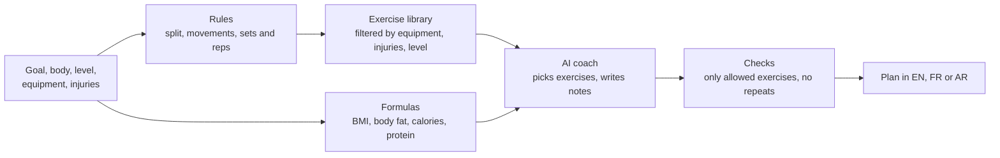

# DimaFit

A workout plan and daily nutrition targets, built from a goal, body measurements, experience and equipment.
In **English, French and Arabic**, printable or saved as a PDF.

**Live demo:** https://dimafit.35-180-91-97.sslip.io

## What it does

- **Goals:** lose fat, build muscle, get stronger, or get fitter.
- **Your numbers:** BMI, body fat from tape measurements, and maintenance calories.
- **Daily nutrition:** calories, protein, carbs, fat and water, with the expected weekly change.
- **Your week:** a 2–6 day schedule fitted to the session length, plus a warm-up, a 4-week progression, cardio advice and tips.
- **Equipment and injuries:** gym, home with dumbbells, or no equipment. Exercises that strain the knees, lower
  back, shoulders or wrists are left out when those are marked.
- **Swap:** any exercise can be replaced with another one that also fits.
- **Health notices:** for example "check with a doctor first" when age, weight or injuries call for it, or no
  calorie deficit for someone who is underweight.
- **Private:** answers and plans stay in the browser; the server keeps nothing.

## How it works



The numbers and the training structure come from code, not from the AI:

- **BMI:** weight / height².
- **Body fat:** the U.S. Navy tape-measure formula.
- **Energy:** Mifflin-St Jeor BMR × an activity factor.
- **Calories:** about −20 % to lose fat and +10 % to build muscle. The minimum is 1,200 kcal for women and
  1,500 kcal for men, and the deficit is at most 1,000 kcal.
- **Protein:** 1.5–2.0 g per kg. Above a BMI of 30 it uses the weight at BMI 25.
- **Splits:** full body, upper/lower, or push/pull/legs, depending on days and experience. Sets, reps and rest
  follow the goal, with heavy 3–5 rep sets kept for barbell-type lifts.

The AI ([Groq](https://groq.com), `openai/gpt-oss-120b` with `qwen/qwen3.8-27b` and `openai/gpt-oss-20b` as
fallbacks) only chooses among the exercises the rules allow for each slot (a strict JSON schema with an enum of
exercise ids). It writes the coaching cues, summary, warm-up, progression and tips in the person's language, using
the right form of address ("vous" in French, feminine forms in Arabic where needed).

Every answer is checked. An exercise that isn't allowed, or appears twice in a day, is replaced, and texts in the
wrong language are dropped. If the AI is busy, a complete plan is still built from the rules and fixed texts.

## Stack

FastAPI · Pydantic · React 19 · TypeScript · Tailwind 4 · Groq AI · Docker

## Run locally

```bash
cd backend
echo "GROQ_API_KEY=gsk_..." > .env
set -a; . ./.env; set +a
uv run uvicorn app.main:app --port 8040 --reload

# in another terminal: http://localhost:5173
cd frontend && npm install && npm run dev
```

Without a Groq key the app still works: plans are built from the rules and fixed texts.

## Tests

```bash
cd backend && uv run pytest
```

## Deploy

```bash
docker build -t dimafit:latest .
docker save dimafit:latest | gzip | ssh SERVER 'gunzip | sudo docker load'
ssh SERVER 'cd ~/dimafit && sudo docker compose -f compose.vps.yml up -d'
```

`deploy/compose.vps.yml` runs the container on the shared Docker network `web` behind Caddy, with a 200 MB memory
limit. The app has no database.

---

DimaFit gives general fitness guidance, not medical advice.
